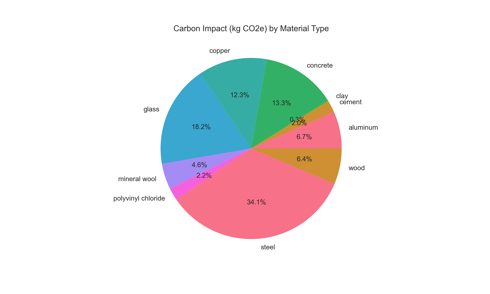

# Life Cycle Assessment of Construction Products

Final project for CE49X Data Science for Civil Engineers, Boğaziçi University, Spring 2025.

The project compares the environmental impact of 20 construction products over their life cycle:
manufacturing, transportation and end of life. For each product it calculates carbon, energy, water
and waste, and then compares products and materials.

## Who did what

The instructor gave a starter package with the module layout, the calculation core, a test suite,
sample data and impact factors. My work on top of it:

- **Data validation:** rewrote `src/data_input.py` so that it reports which column or row fails,
  checks numeric types directly and checks that recycling, landfill and incineration rates add up to 1.
- **Visualisation:** changed `src/visualization.py` and updated the tests to match.
- **Analysis:** wrote the full analysis notebook, `notebooks/lca_analysis_final.ipynb`, with
  impact calculation, product comparison, normalisation and comparison of alternatives.
- **Results:** made all figures and tables in `results/` and wrote the two reports,
  `Documentation/LCA_Project_Report.pdf` and `results/LCA_Report.pdf`.

## Main findings



- Steel causes the largest share of carbon, about 34% of the total, then glass at 18% and concrete at 13%.
- For the same structural role, the engineered wood beam emits about 300 kg CO2e, while the structural
  steel beam emits about 1,850 kg CO2e. That is roughly six times more.
- Reinforced concrete has the highest water use and waste of all products, so a material that looks
  good on carbon is not always good on other impacts. This is why the tool keeps the impact
  categories separate before normalising them.

All product totals are in `results/total_impact_results.csv`.

## How to run

```bash
pip install -r requirements.txt
pytest                      # 13 tests
jupyter notebook notebooks/lca_analysis_final.ipynb
```

```python
from src.data_input import DataInput
from src.calculations import LCACalculator
from src.visualization import LCAVisualizer

data_input = DataInput()
product_data = data_input.read_data('data/raw/sample_data.csv')

calculator = LCACalculator(impact_factors_path='data/raw/impact_factors.json')
impacts = calculator.calculate_impacts(product_data)

visualizer = LCAVisualizer()
fig = visualizer.plot_impact_breakdown(impacts, 'carbon_impact', 'material_type')
```

## Data structure

Product data is a CSV file with one row per product and life cycle stage. The columns are
`product_id`, `product_name`, `life_cycle_stage`, `material_type`, `quantity_kg`,
`energy_consumption_kwh`, `transport_distance_km`, `transport_mode`, `waste_generated_kg`,
`recycling_rate`, `landfill_rate`, `incineration_rate`, `carbon_footprint_kg_co2e` and `water_usage_liters`.
The three rates are fractions between 0 and 1 and must add up to 1.

Impact factors are a JSON file organised by material, then by life cycle stage:

```json
{
    "steel": {
        "manufacturing": {"carbon_impact": 1.8, "energy_impact": 20.0, "water_impact": 150.0}
    }
}
```

The sample data and impact factors are teaching data provided with the course, not measured values.
